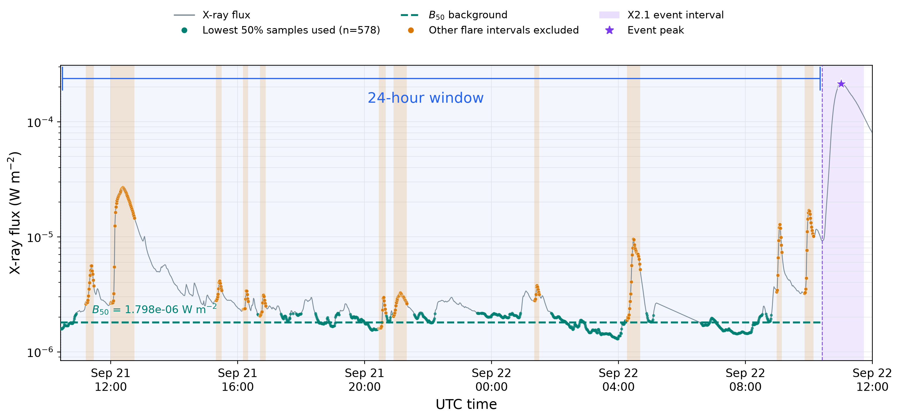

# rxfi-benchmark

This repository contains reproducible data definitions and target-generation code for 24-hour solar-flare forecasting windows. It combines frozen temporal splits from the [NASA-IBM SuryaBench flare-forecasting dataset](https://huggingface.co/datasets/nasa-ibm-ai4science/surya-bench-flare-forecasting) with the NOAA/NCEI [GOES XRS Flare Report CSV](https://data.ngdc.noaa.gov/platforms/solar-space-observing-satellites/goes/multi/l2/data/xrsf-l2-flrpt_science/csv/sci_xrsf-l2-flrpt_geo_s19950103_e20261012_v1-0-1.csv) and [science-quality GOES XRS data](https://www.ncei.noaa.gov/products/goes-1-15/space-weather-instruments), which includes Level 2 one-minute averages.

## Data sources and temporal splits

The forecasting samples use the published SuryaBench split CSVs. The split membership follows the source dataset's temporal policy:

| Split | Time range and rule | Rows |
| --- | --- | ---: |
| Train | February 15–December 31, 2010–2019 | 74,760 |
| Validation | January 15–31, 2010–2019 | 3,672 |
| Leaky validation | January 1–14 and February 1–14, 2010–2019 | 6,048 |
| Test | January 1, 2020–December 31, 2024 | 43,848 |

The four split files contain 128,328 hourly timestamps in total. They are read as immutable inputs; generated files preserve each input row, column, timestamp, and row order. Their source and SHA-256 checksums are recorded in [`target_generation_metadata.json`](outputs/target_generation_24h/target_generation_metadata.json). The source split files and generated CSVs are local data products and are not included in Git.

The NOAA/NCEI GOES XRS Flare Report supplies flare event times, start/end intervals, classes, and peak irradiance. Its `background_irrad` field is retained for comparison and is **not used** in the current RXFI targets. Those backgrounds are calculated separately from science-quality GOES XRS Level 2 `avg1m` XRS-B observations (`xrsb_flux`, `xrsb_flag`, and the catalog-selected satellite). The example plot uses the [GOES-15 2011 Level 2 one-minute XRS file](https://www.ncei.noaa.gov/data/goes-space-environment-monitor/access/science/xrs/goes15/xrsf-l2-avg1m_science/sci_xrsf-l2-avg1m_g15_y2011_v2-2-1.nc). Full input URLs and SHA-256 checksums are recorded in [`configs/paper_background_sensitivity.inputs.lock.json`](configs/paper_background_sensitivity.inputs.lock.json). See the [catalog and XRS field definition](docs/research/noaa_xrs_catalog_and_rxfi_definition.md) for details.

## New XRS-only research targets

The approved research direction defines four continuous targets directly from
science-quality, one-minute GOES XRS Level 2 XRS-B measurements. For a forecast
start `s`, the prediction interval is `[s, s + 24 h)` and the fixed background
is the mean of the lower 50% of valid samples in `[s - 24 h, s)`.
The targets are `max_xflux`, `fluence`, `max_background_deviation`, and
`total_background_deviation`. Deviation targets are signed and are not clipped
at zero. Only the background interval changed in the current definition:
`max_xflux` and `fluence` do not use a background and remain unchanged, while
the deviation targets use the lower-50% mean over `[s - 24 h, s)`. Fluence and
total deviation use the discrete one-minute sum multiplied by 60 seconds. NOAA
flare catalog data will be reserved for operational-skill evaluation on the
test set, not used to generate these targets.

The reproducible generator is [`scripts/data/generate_xrs_only_targets.py`](scripts/data/generate_xrs_only_targets.py).
It downloads the four frozen SuryaBench split indexes and NOAA annual XRS files,
then writes the new targets to `data/derived/{train,validation,leaky_validation,test}_targets.csv`.
Previous catalog-based files are retained in
`data/derived/legacy_catalog_targets/`. Missing measurements are not
interpolated; valid-sample coverage and source satellite counts are recorded
per window. The exact input URLs and SHA-256 checksums are recorded in each
run's `target_generation_metadata.json`.

The NOAA primary/secondary satellite schedule follows
[the GOES Flare Report ReadMe, Appendix A, Table 5](https://data.ngdc.noaa.gov/platforms/solar-space-observing-satellites/goes/goes16/l2/docs/GOES_Flare_Report_ReadMe.pdf).
For each minute, the scheduled primary is used when its measurement passes
quality filtering; the scheduled secondary fills that minute only if the
primary sample is unavailable. NOAA's direct annual file links use these
official layouts:

- GOES-8–15: [NCEI archive](https://www.ncei.noaa.gov/data/goes-space-environment-monitor/access/science/xrs/), `goes{N}/xrsf-l2-avg1m_science/sci_xrsf-l2-avg1m_g{N}_y{YYYY}_v2-2-1.nc` (example: scheduled primary [GOES-15 2012](https://www.ncei.noaa.gov/data/goes-space-environment-monitor/access/science/xrs/goes15/xrsf-l2-avg1m_science/sci_xrsf-l2-avg1m_g15_y2012_v2-2-1.nc) and secondary [GOES-14 2012](https://www.ncei.noaa.gov/data/goes-space-environment-monitor/access/science/xrs/goes14/xrsf-l2-avg1m_science/sci_xrsf-l2-avg1m_g14_y2012_v2-2-1.nc)).
- GOES-16–19: [NOAA/NCEI GOES-R archive](https://data.ngdc.noaa.gov/platforms/solar-space-observing-satellites/goes/), `goes{N}/l2/data/xrsf-l2-avg1m_science/sci_xrsf-l2-avg1m_g{N}_y{YYYY}_v2-2-1.nc` (example: scheduled primary [GOES-16 2023](https://data.ngdc.noaa.gov/platforms/solar-space-observing-satellites/goes/goes16/l2/data/xrsf-l2-avg1m_science/sci_xrsf-l2-avg1m_g16_y2023_v2-2-1.nc) and secondary [GOES-18 2023](https://data.ngdc.noaa.gov/platforms/solar-space-observing-satellites/goes/goes18/l2/data/xrsf-l2-avg1m_science/sci_xrsf-l2-avg1m_g18_y2023_v2-2-1.nc)).

See [the XRS-only target specification](docs/research/xrs_only_target_definitions.md)
for formulas, satellite policy, and missing-data handling.

## Legacy catalog-based forecast-window targets

For every split timestamp `t`, events with catalog peak times in the half-open interval `[t, t + 24 h)` contribute to the four continuous targets:

| Target | Definition |
| --- | --- |
| `max_peak_flux` | Largest valid positive NOAA event peak in the window, in W m^-2 |
| `cumulative_peak_flux` | Sum of valid positive event peaks in the window, in W m^-2 |
| `max_rxfi` | Largest event RXFI in the window |
| `cumulative_rxfi` | Sum of event RXFIs in the window |

The revised project definition places each catalog event's 24-hour background window one day before its start: `[t_start - 48 h, t_start - 24 h)`. It uses same-satellite, positive finite XRS-B `avg1m` samples, removes `xrsb_flag != 0` and samples inside another catalog flare's start–end interval, and averages the lowest `ceil(N/2)` remaining measurements as `B50`. RXFI is the fractional increase above that background:

$$
\mathrm{RXFI}_{50}=\frac{F_{\mathrm{peak}}-B_{50}}{B_{50}}.
$$

This lower-50% estimator is a project adaptation intended to reduce residual flare elevation after event-interval masking. It does not use NOAA `background_irrad`, does not apply the paper's start-time upper cap, and does not use `POST_EVENT`. The published paper's filtered 24-hour background procedure is summarized in [the method note](docs/research/paper_based_background_xray_flux_method.md); the selected project adaptation and its caveats are documented in [lower50_background_rxfi.md](docs/research/lower50_background_rxfi.md).

**Recalculation status:** the current event-background script, saved event table, split target CSVs, and example figure still use the previous interval `[t_start - 24 h, t_start)`. They have not yet been regenerated using the revised definition above. The separate FQ pseudo-event background remains peak-anchored as documented below.

<!--
### Background calculation example

The example below shows the calculation for the 2011-09-22 X2.1 flare. Orange dots and shading mark other flare intervals excluded from the background calculation; teal dots show the lowest 50% of eligible samples, and the dashed line marks their mean (`B50`). The purple region marks the target flare interval.


-->

The legacy FQ regression targets use one pseudo-event per no-catalog-peak window: the maximum valid science-quality XRS-B one-minute flux in `[t,t+24 h)`. Its background is the lower-50% mean from `[a−24 h−5 min, a−5 min)`, where `a` is the time of the window maximum; its relative increase is `(F_peak - B50) / B50`. Thus, for FQ, `max_peak_flux = cumulative_peak_flux`, and `max_rxfi = cumulative_rxfi`. Negative RXFI is excluded under the legacy rule and yields zero for both RXFI targets. If the maximum or its background cannot be calculated, the corresponding targets are missing rather than imputed as zero. The five-minute offset is a project-selected buffer, not a universal NOAA detection delay. This rule is implemented in the [legacy target generator](scripts/data/generate_24h_targets.py) and documented in the [target-generation specification](docs/research/24h_target_generation.md) and [background method note](docs/research/lower50_background_rxfi.md).

**Negative event-level RXFI values do occur:** 261 of 41,723 catalog events in the 2010–2025 source period (0.63%) have a peak below `B50`; their calculated values remain in the event-level `event_backgrounds.csv`. For catalog-event targets, these events are excluded from `max_rxfi` and `cumulative_rxfi`, but remain in the peak-flux targets. If a window has no non-negative RXFI events, both RXFI targets are zero. QC on the 128,328 existing generated windows found 0 negative `max_rxfi` values and 0 negative `cumulative_rxfi` values.

The current split-specific files are `data/derived/{train,validation,test,leaky_validation}_targets.csv`. Target summaries, row-alignment checks, quality counts, and figures are in [`outputs/target_generation_24h/`](outputs/target_generation_24h/). Local target CSVs are ignored by Git because they are reproducible data products.

## Reproduce the data products

Create and activate the project environment:

```bash
conda env create -f environment.yml
conda activate rxfi-benchmark
```

Generate or regenerate the XRS-only targets and coverage QC:

```bash
conda run -n rxfi-benchmark python scripts/data/generate_xrs_only_targets.py
```

The generator resolves and records the Hugging Face dataset commit. For a
strict offline rerun, use the same commit SHA recorded in metadata and retain
all cached input files:

```bash
conda run -n rxfi-benchmark python scripts/data/generate_xrs_only_targets.py \
  --revision <40-character-commit-sha> --offline
```

See [scripts/data/README.md](scripts/data/README.md) for the exact data source
layouts and [the XRS-only target definition](docs/research/xrs_only_target_definitions.md)
for method details.

Download the four source split files from the dataset repository into the local raw-data directory:

```bash
mkdir -p data/raw/surya_bench_splits
for split in train validation test leaky_validation; do
  curl -L "https://huggingface.co/datasets/nasa-ibm-ai4science/surya-bench-flare-forecasting/resolve/main/${split}.csv" \
    -o "data/raw/surya_bench_splits/${split}.csv"
done
```

Recalculate the lower-50% event backgrounds using the pinned NOAA flare report and XRS inputs. Offline mode requires those inputs in `data/raw/noaa_paper_background/`; omit `--offline` to download missing pinned inputs:

```bash
python scripts/background/compute_paper_background_sensitivity.py \
  --config configs/background_lower50.json --offline
```

The command writes `event_backgrounds.csv` under `outputs/background_lower50/runs/<fingerprint>/`. Use that file and the matching NOAA catalog to regenerate the four split targets:

```bash
python scripts/data/generate_24h_targets.py \
  --data-dir data/raw/surya_bench_splits \
  --noaa-csv data/raw/noaa_paper_background/sci_xrsf-l2-flrpt_geo_s19950103_e20261012_v1-0-1.csv \
  --rxfi-method lower50 \
  --lower50-backgrounds-csv outputs/background_lower50/runs/<fingerprint>/event_backgrounds.csv \
  --derived-dir data/derived \
  --output-dir outputs/target_generation_24h
```

Replace `<fingerprint>` with the run directory created by the background calculation. The generator records checksums for the input catalog, background table, and split files; it also checks that split row identity is preserved. See the [target-generation specification](docs/research/24h_target_generation.md) for details.

## Repository layout

```text
rxfi-benchmark/
├── configs/          # Pinned data and background configurations
├── data/             # Local source caches and derived targets (gitignored)
├── docs/research/    # Data definitions, provenance, and methodology
├── outputs/          # Reproducibility summaries and data-quality artifacts
├── scripts/          # Data download, background, and target-generation tools
└── environment.yml   # Conda environment for data workflows
```

## Data documentation

- [NOAA XRS catalog fields and RXFI definition](docs/research/noaa_xrs_catalog_and_rxfi_definition.md)
- [Approved XRS-only regression target definitions](docs/research/xrs_only_target_definitions.md)
- [Selected lower-50% background method and event results](docs/research/lower50_background_rxfi.md)
- [Paper-based 24-hour background procedure](docs/research/paper_based_background_xray_flux_method.md)
- [Deterministic 24-hour target generation](docs/research/24h_target_generation.md)
- [Background calculation run guide](outputs/background_lower50/README.md)

## License

This code is released under the [Apache License 2.0](LICENSE). Users are responsible for complying with the terms of external data providers.
