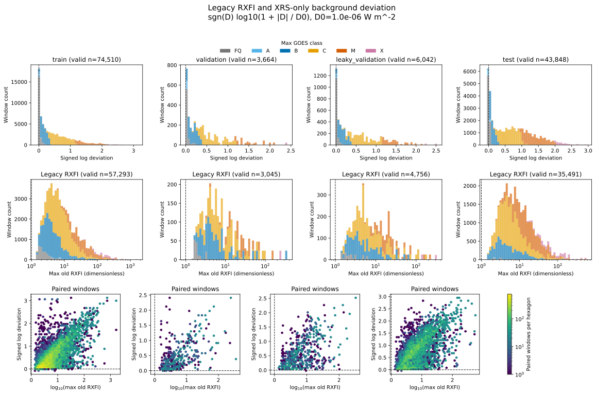

# Exploratory comparison of legacy RXFI and background deviation

## Question and scope

This exploratory label audit compares the supplementary catalog-based
`max_old_rxfi` with the XRS-only `max_background_deviation`. It evaluates
availability, distribution, reference-value categories, and paired rank
association. It does not compare model performance or establish operational
forecast skill.

## Compared labels and cohort

For a split window beginning at `t`, `max_old_rxfi` is the largest event-level
ratio `peak_flux / old_background` among NOAA catalog events whose
`start_time` lies in `[t, t + 24 h)`. The old event background is calculated
from `[flare_start - 24 h, flare_start)`, with the event's flare masking and
start-flux cap.

`max_background_deviation` is the maximum signed XRS-B difference
`max_i(F_i - B_t)` over eligible samples in `[t, t + 24 h)`. Its fixed
background `B_t` is the lower-50% mean from `[t - 24 h, t)`. It is an absolute
irradiance difference, not a dimensionless ratio.

Class colors use the `max_goes_class` values already stored in each split
(`FQ`, `A`, `B`, `C`, `M`, or `X`, grouped by letter). They are not re-matched
or regenerated from the supplemental NOAA catalog for this figure. `FQ` is
the split's quiet/no-flare category, not a conventional GOES letter class.

The comparison joins the current XRS-only split CSV to the supplementary
old-RXFI copy by UTC timestamp and checks that timestamp sets match. The
paired cohort includes rows where both target values are finite. A missing
old RXFI is never imputed as zero: windows without a catalog flare or without
a valid event-level old RXFI remain missing. Coverage counts retain the full
split denominator, while distribution summaries and cross-tabs use the paired
cohort.

## Analysis procedure

- Produce per-split coverage counts and report the two labels' descriptive
  statistics in their original target units.
- For the figure only, transform signed background deviation as
  `sgn(D) * log10(1 + abs(D) / D0)`, with fixed `D0 = 1e-6 W m^-2`.
  This keeps zero at zero, preserves the sign, and compresses large deviations.
  The deviation histogram uses every split row with a valid deviation and is
  stacked by the stored `max_goes_class` letter (`FQ`, `A`, `B`, `C`, `M`,
  `X`); its count axis is linear. The old-RXFI histogram uses every positive,
  valid old-RXFI value, is stacked by the same stored classes, and has a
  logarithmic x-axis with its ratio-one reference point. Missing old RXFI is
  not imputed, so rows without a catalog flare do not appear in that histogram.
- Show the paired relationship using `log10(max_old_rxfi)` and the same
  signed-log background deviation. The plotted transform does not change the
  source labels, summary statistics, or cross-tabulation values.
- Cross-tabulate `max_old_rxfi < 1`, `= 1`, `> 1` against
  `max_background_deviation < 0`, `= 0`, `> 0`.
- Calculate Spearman rank correlation on paired windows. Its 95% interval is
  a percentile interval from 200 resamples of seven-day date blocks with seed
  `20261015`. It describes sampling variability; it is not a significance
  test.
- Include test split values only as descriptive context. Since those values
  are now visible, this audit is not an independent test of a target choice.

## Observations

The four splits contain 128,328 windows. `max_background_deviation` is valid
for 128,064 windows; `max_old_rxfi` is valid for 100,585. Both values are
available for 100,501 paired windows. The 27,743 missing old-RXFI rows consist
of 27,671 windows without a catalog flare and 72 windows with no valid old
RXFI event. Another 264 windows lack a valid background-deviation target.

| Split | Paired windows | Median max background deviation (W m$^{-2}$) | Median max old RXFI | Spearman $\rho$ (95% block-bootstrap interval) |
| --- | ---: | ---: | ---: | ---: |
| Train | 57,223 | $2.016\times10^{-6}$ | 6.423 | 0.725 (0.689–0.754) |
| Validation | 3,037 | $1.445\times10^{-6}$ | 6.287 | 0.652 (0.516–0.746) |
| Leaky validation | 4,750 | $2.269\times10^{-6}$ | 6.672 | 0.604 (0.463–0.754) |
| Test | 35,491 | $5.021\times10^{-6}$ | 7.560 | 0.655 (0.612–0.696) |

On the paired cohort, all 100,501 `max_old_rxfi` values exceed 1. The
background-deviation values are positive in 100,438 windows, negative in 63,
and exactly zero in none. Thus the 63 windows with negative deviation still
have an old-RXFI ratio above 1.



## Interpretations

The positive rank association in every split indicates that windows ranked
higher by legacy RXFI often also rank higher by maximum background deviation.
The relationship is not one-to-one: the labels differ in units, background
interval, event selection, and aggregation. In particular, a negative
XRS-only deviation can coexist with an old RXFI above 1 because the former
compares all eligible future samples against the forecast-start background,
while the latter is a flare-event peak divided by an event-specific capped
background.

The different split medians are descriptive and may reflect temporal changes
in solar activity and data coverage. They do not establish which target is
more learnable or operationally useful.

## Justified claims

- The paired labels have a positive monotonic association in each split under
  the specified calculation.
- Their reference categories are not equivalent: every valid old-RXFI ratio
  is above 1, while 63 paired background deviations are negative.
- Missing old RXFI is mostly associated with no catalog event, not a zero
  target.

## Unsupported or unresolved claims

- This audit does not show which label yields better model learnability,
  severe-flare discrimination, or operational value.
- The test split was summarized for this audit. A target or procedure choice
  informed by these results is no longer independent of the existing test
  cohort; a future independent evaluation cohort would be needed for that
  choice.
- The bootstrap intervals are descriptive and do not test whether split
  correlations differ. Seven-day blocks may not capture every dependence
  pattern in the overlapping 24-hour windows.

## Reproduction and outputs

From the repository root, run with the project environment:

```bash
conda run -n rxfi-benchmark python scripts/analysis/compare_old_rxfi_and_background_deviation.py
```

The script checks timestamp alignment and source schemas, then writes the
following under `outputs/old_rxfi_background_deviation_comparison/`:

- `split_coverage.csv`: valid/missing counts and old-RXFI status accounting.
- `paired_target_summaries.csv`: descriptive statistics on the common cohort.
- `paired_reference_cross_tab.csv`: counts for the 3-by-3 reference table.
- `paired_association.csv`: Spearman association and block-bootstrap interval.
- `analysis_metadata.json`: input hashes, definitions, bootstrap settings, and
  figure provenance.
- `figures/old_rxfi_vs_background_deviation.svg` and `.png`.

The same SVG and PNG figures are copied to `docs/research/assets/` so this
document can display the generated comparison. The output directory is
generated locally and is not a replacement for the source split files. The
script accepts `--input-dir`, `--old-rxfi-dir`, `--output-dir`, `--figure-dir`,
`--block-days`, `--bootstrap-replicates`, `--seed`, and `--deviation-scale`.
The default deviation scale is `1e-6 W m^-2`; the chosen value is stored in
`analysis_metadata.json` and shown on the figure axes.
